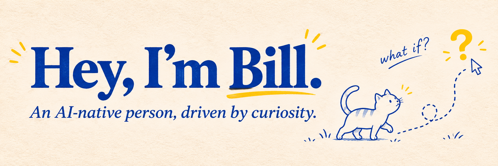

[English](./README.md) · [简体中文](./README.zh-CN.md) · [Project collections](./COLLECTIONS.md)

[Personal website ↗](https://heybill.cc) · WeChat Official Account: **比尔的小屋** · Search this name in WeChat.

# Hey, I’m Bill 👋

**An AI-native person, driven by curiosity.**

I like turning “what if?” into things people can use—and sharing what I learn along the way.

I’m curious about how people learn, make decisions, and get through everyday life. Building with AI gives me a way to explore those questions, try things out, and discover the questions I hadn’t thought to ask.

## Things I’ve been building

### 📖 From reading to remembering

**[Anki Card Skills](https://github.com/Bill306/anki-card-skills)**

Reading something and remembering it are two different challenges. This agent skill turns PDFs into reviewable Anki cards, with source pages attached and an `.apkg` export.

**[Browse the sample cards](https://github.com/Bill306/anki-card-skills/blob/main/examples/lumabox/output/review.md)** · [Download the Anki deck](https://github.com/Bill306/anki-card-skills/raw/refs/heads/main/examples/lumabox/output/deck.apkg) · [Read the product case](./projects/anki/README.md)

The decision worth looking at: keep the source page beside the answer, and record questions the material cannot answer. The included sample lets you inspect both the cards and the missing information before importing anything.

### 🔎 What happened behind the chart?

**[Forensics](https://github.com/Bill306/forensics)**

A price chart can leave you wondering what happened along the way. Forensics brings an agent research workflow into a web interface for generating charts annotated with events and turning points. The public app provides the interface and an example skill; users can connect their own research skill.

**[See a real chart result](https://github.com/Bill306/forensics/blob/main/docs/screenshots/05-real-samsung-chart.png)** · [Explore the workflow and product case](./projects/forensics/README.md)

The decision worth looking at: show the resolved company and market before starting a generation request. The case also explains the waiting experience and the open/download flow. The public result above is a screenshot; running new research requires your own deployment and skill.

### 🐱 Less calculating. More travelling.

**[喵喵旅账 · TripSplit](./projects/tripsplit/README.md)**

A shared travel ledger built as a WeChat mini program: record expenses in different currencies, choose who shares each cost, and work out who pays whom.

**[Take the product tour](./projects/tripsplit/README.md#product-tour)** · [Read the settlement decision](./projects/tripsplit/README.md#why-payment-and-receipt-have-separate-confirmations)

The decision worth looking at: a payer marking a transfer as sent and a recipient confirming it arrived are separate steps. The public tour follows the expense-to-settlement flow; WeChat access is available to discuss with me.

## Questions I keep coming back to

- What makes a product useful enough to come back to?
- When should an AI act, and when should it ask?
- How can people check an AI’s work and decide whether to trust it?

These questions connect a lot of what I build. I’m interested in the choices around the model: what someone needs to tell it, how they understand the result, and what they can do next.

## Something we could build together?

I’m open to AI product opportunities and meeting people who enjoy making things, asking thoughtful questions, and learning through the work.

Have an idea, a question, or a project you’d like to explore together? [Say hello here](https://github.com/Bill306/Bill306/issues). For feedback on a particular project, its own repository is a good place to start.

*There’s usually another “what if?” on my mind.*
