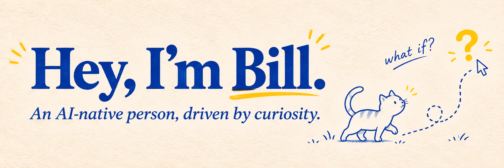

[English](./README.md) · [简体中文](./README.zh-CN.md) · [LinkedIn](https://www.linkedin.com/in/billdeng321)

# 你好，我是 Bill 👋

**一个 AI-native 的人，始终保持好奇。**

我喜欢把“如果可以这样呢？”变成能够使用的东西，也喜欢分享这个过程中的发现。

我好奇人们如何学习、如何做决定，以及如何处理生活里的各种事情。通过 AI 制作产品，让我有机会亲手探索这些问题，也常常发现一些原本没有想到的新问题。

## 最近制作的东西

### 📖 读过之后，怎样才能记住？

**[Anki Card Skills](https://github.com/Bill306/anki-card-skills)**

读懂一份材料之后，还需要找到适合自己的复习方式。这个 Agent Skill 把 PDF 转成可以审阅的 Anki 卡片，保留来源页码，并导出 `.apkg` 文件。

这个项目关注的问题是：什么样的卡片值得拿来复习？因此，每张卡片围绕一个回忆目标，答案能够追溯到资料，导出之前也保留了审阅的机会。

### 🔎 图表背后，发生了什么？

**[Forensics](https://github.com/Bill306/forensics)**

看到一张股价图表，我会想知道其中的变化对应着什么事件。Forensics 把 Agent 研究流程放进网页界面，用来生成带有事件和转折点说明的图表。公开项目提供界面和示例 Skill，使用者可以接入自己的研究 Skill。

其中一个产品问题是：研究需要几分钟，等待的人怎样理解这个过程？项目为此设计了生成前的预览、等待状态，以及可以打开和下载的图表结果。

### 🐱 少算一点账，多享受旅程

**[喵喵旅账 · TripSplit](https://github.com/Bill306/tripsplit-wechat-miniprogram)**

一个微信多人旅行账本：记录不同货币的开支，选择每笔费用由哪些人分摊，并计算最后需要怎样转账。

有意思的地方藏在同行朋友的各种情况里：有人垫付，部分成员参加活动，转账之后还需要确认收款。这个项目把这些情况放进完整的使用流程，从记录开支一直到确认结算。

## 我经常想起的问题

- 什么样的产品，会让人愿意再次使用？
- AI 应该什么时候行动，什么时候询问？
- 怎样让人检查 AI 的工作，并判断是否值得信任？

这些问题贯穿着我的许多项目。我关注模型周围的产品设计：用户需要提供什么信息，怎样理解结果，以及接下来能够采取什么行动。

## 一起制作点什么？

我正在关注 AI 产品相关的工作机会，也希望认识喜欢制作产品、认真提问、在过程中不断学习的人。

有想法想聊聊，有问题想一起研究，或者有项目想邀请我参与，可以[在这里打个招呼](https://github.com/Bill306/Bill306/issues)。具体项目的建议与交流，也欢迎直接前往对应的仓库。

*脑海里，通常还有下一个“如果可以这样呢？”。*
