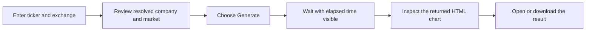

# Forensics · What should happen before “Generate”?

**English** · [简体中文](README.zh-CN.md) · [Back to Bill](../../README.md) · [Project](https://github.com/Bill306/forensics)

A bend in a chart is a good place to start asking questions.

## See the result

**[Open the saved Samsung Electronics chart screenshot](https://github.com/Bill306/forensics/blob/main/docs/screenshots/05-real-samsung-chart.png).** Zoom in to inspect the price history and accompanying event annotations. This is a saved result from a research-skill run, presented as an image.

For a new generation request, follow the project's [local setup](https://github.com/Bill306/forensics#local-development). The public application includes an example Skill; full research requires supplying your own research Skill and model credentials.

## Walk through the application

The backend resolves metadata before generation. The interface presents a preview, starts a generation request after confirmation, and embeds the returned HTML file when it is ready. Open and download controls let the visitor continue with the result outside the application view.

## Decision: confirm the subject before starting research

**The user problem.** A ticker can refer to different markets. Starting research on the wrong company wastes both waiting time and a model request.

**The design.** Separate ticker resolution from generation. Show the company and market in the preview, then let the user choose Generate. Numeric tickers require an exchange prefix, such as `KRX:005930`.

**The consequence.** The flow adds a confirmation step and gives users a point at which to check the research subject. It also makes a lookup error visible before generation begins.

**Inspect it.** The separation is visible in the public [backend routes](https://github.com/Bill306/forensics/blob/main/app.py) and [interface](https://github.com/Bill306/forensics/blob/main/templates/index.html).

## Decision: explain the wait and keep the result usable

Research can take several minutes. The interface keeps elapsed waiting time visible and moves to the result when the request returns. Its Research/Data/Render labels cycle on a timer; they are illustrative activity labels. The timer records elapsed time, while completion is established by the returned request and file.

The generated HTML can be opened or downloaded. That gives the output a useful life beyond the search page: someone can inspect it separately and retain the delivered file.

## Decision: reuse recent output and show its age

The backend reuses an existing chart file when it is less than 24 hours old. The result label identifies cached output and its age. This reduces repeated generation for the same resolved symbol while making freshness visible. The cache is keyed by symbol; time passing and changes to research inputs still matter when interpreting a saved result.

## Evidence and current scope

This case is based on the public application code and saved chart image. The image demonstrates an existing output; it provides no live controls. A new research run depends on the supplied Skill, model access, and market-data availability. Event dates and explanations need checking against their underlying sources.

[Project and setup](https://github.com/Bill306/forensics) · [Back to the other projects](../../README.md#things-ive-been-building)
