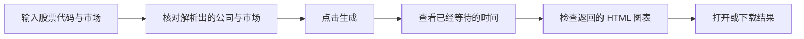

# Forensics · 点击「生成」之前，应该发生什么？

[English](README.md) · **简体中文** · [返回 Bill 的主页](../../README.zh-CN.md) · [项目仓库](https://github.com/Bill306/forensics)

图表里的一次转折，往往也是一个问题的开始。

## 查看作品结果

**[打开已保存的三星电子图表截图](https://github.com/Bill306/forensics/blob/main/docs/screenshots/05-real-samsung-chart.png)。** 放大之后，可以查看价格变化和对应的事件说明。这张图片来自一次使用研究 Skill 生成的结果。

如果希望生成新的研究，可以按照项目的[本地运行说明](https://github.com/Bill306/forensics/blob/main/README.zh-CN.md#本地运行)配置。公开应用附带示例 Skill；完整研究需要提供自己的研究 Skill 和模型配置。

## 了解应用流程

后端在生成之前解析股票元数据。界面展示预览，用户确认之后发起生成请求，完成后在页面中显示返回的 HTML 文件。打开和下载入口，让用户能够在应用页面之外继续查看结果。

## 设计选择：开始研究之前，确认研究对象

**用户的问题。** 股票代码可能对应不同市场。研究对象选择错误，会同时消耗等待时间和模型调用。

**产品设计。** 股票解析与生成分别进行。预览中展示公司和市场，用户核对之后再点击生成。纯数字代码需要提供交易所前缀，例如 `KRX:005930`。

**带来的影响。** 使用流程增加了一次确认，也给用户提供了检查研究对象的机会。查询错误能够在生成开始之前展示。

**怎样核对。** 这些行为可以在公开的[后端接口](https://github.com/Bill306/forensics/blob/main/app.py)和[界面文件](https://github.com/Bill306/forensics/blob/main/templates/index.html)中查看。

## 设计选择：说明等待过程，让结果便于继续使用

研究可能需要几分钟。界面持续显示已经等待的时间，请求返回后展示结果。Research、Data、Render 标签按定时器轮换，用于提示处理活动。计时器记录等待时长，任务完成由请求返回及输出文件确认。

生成的 HTML 可以单独打开或下载。这样，结果能够继续被查看，也能够以文件形式保留。

## 设计选择：复用近期结果，同时展示时间

后端会复用生成时间不足二十四小时的现有图表文件。界面标明缓存结果及其生成时间间隔，使用户能够判断新旧程度，同时减少同一股票的重复生成。缓存按照解析出的股票标识保存；理解结果时，仍然需要考虑时间变化与研究输入的变化。

## 依据与当前范围

这个案例依据公开应用代码和已保存的图表图片整理。图片展示已有结果；生成新研究依赖所提供的 Skill、模型访问权限和市场资料。事件日期与解释需要结合原始来源核查。

[项目与运行说明](https://github.com/Bill306/forensics/blob/main/README.zh-CN.md) · [继续浏览其他作品](../../README.zh-CN.md#最近制作的东西)
