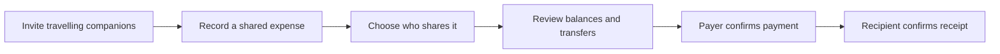

# TripSplit · 喵喵旅账 🐱

**English** · [简体中文](README.zh-CN.md) · [Back to Bill](../../README.md)

**Less calculating. More travelling.**

Dinner for six. A taxi for three. One friend paid in another currency. A shared trip has plenty of little accounting puzzles; the holiday deserves more attention.

TripSplit is a WeChat mini program for travelling together: record shared expenses, choose participants, and understand the transfers needed to settle up.

## A trip in three moments

1. **“Who is coming?”** Bring companions into the same trip and keep people recorded on someone else's behalf identifiable.
2. **“Who joined this one?”** Choose participants for each expense. Preserve its original amount, settlement currency, and saved exchange rate.
3. **“Are we settled?”** Review the suggested transfers. Payment and receipt have separate confirmations, with a record of who confirmed each step.

## The product choices I find interesting

Fairness needs an explanation people can check. A total alone cannot tell a friend why they owe that amount. Expense participants, the original currency, and the confirmation history give the group a shared reference.

The small human moments matter: someone joins later, someone pays for everyone, and someone asks whether a transfer arrived. The flow makes room for those conversations.

## Product access

This page is a portfolio walkthrough. Public availability in WeChat has not been verified, so it contains no launch code or claimed live demo. For questions about trying the mini program, [contact Bill](https://github.com/Bill306/Bill306/issues).

WeChat Official Account: **比尔的小屋**.
