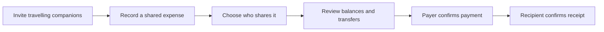

# TripSplit · 喵喵旅账 🐱

**English** · [简体中文](README.zh-CN.md) · [Back to Bill](../../README.md)

**Less calculating. More travelling.**

Dinner for six. A taxi for three. One friend paid in another currency. A shared trip has plenty of little accounting puzzles; the holiday deserves more attention.

TripSplit is a WeChat mini program for travelling together: record shared expenses, choose participants, and understand the transfers needed to settle up.

**[Start the product tour](#product-tour)** · [Read the settlement case](#why-payment-and-receipt-have-separate-confirmations) · [Ask about WeChat access](https://github.com/Bill306/Bill306/issues/new?title=TripSplit%20product%20access)

## Product tour

This public walkthrough follows the existing mini program's expense and settlement flow. You can read it on GitHub; trying the mini program itself requires WeChat access arranged with Bill.

[Record an expense](#record-an-expense) → [Check how it was shared](#check-how-it-was-shared) → [Confirm a transfer](#confirm-a-transfer)

### Record an expense

Choose the payer, select the people sharing this particular cost, and enter the amount and currency. The form supports equal or share-unit splitting. It saves a draft while the expense is being edited, so the selected participants and entered details can be restored when returning to the form.

**Look for the decision:** the payer and participants are separate choices. A friend can cover the payment while only part of the group shares the expense.

[Continue to the expense details](#check-how-it-was-shared)

### Check how it was shared

The expense details show who paid and each participant's share. For a foreign-currency expense, the page also shows the original amount and either the saved exchange rate or the actual charged amount used for settlement.

**Look for the decision:** keep the original purchase and the settlement amount connected. Friends can check the currency conversion and their share together.

[Continue to settlement](#confirm-a-transfer)

### Confirm a transfer

Review the proposed transfers. During an active settlement, the payer marks a transfer as paid after sending money through WeChat or a bank. The recipient then checks the incoming payment and confirms receipt. The application records these confirmations.

The visible states are **pending → paid, awaiting receipt → received**. A confirmation dialog shows the people and amount before the record changes.

[Read why these are separate steps](#why-payment-and-receipt-have-separate-confirmations)

## Why payment and receipt have separate confirmations

**The user problem.** “I sent it” and “I received it” describe two people's observations. A group needs to understand which action is still waiting for someone.

**The design.** During active settlement, the payer marks payment and the recipient confirms receipt. The pending receipt remains visible between those actions. The confirmation dialog asks the person to check the transfer before updating the record.

**The consequence.** Settling a transfer involves an extra acknowledgement from the recipient. In return, the group gets an explicit place to distinguish sending money from confirming arrival.

**The situation it covers.** The payer has sent the money and the recipient has yet to confirm arrival. Other members can read the awaiting-receipt status and understand the next action.

## Why the original currency stays with the expense

The original currency, original amount, and saved conversion details help a traveller understand the settlement figure. The form also allows an actual charged amount when that is the useful reference for the group. The choice preserves enough context to discuss an expense after the trip.

## Evidence and product access

This case describes the current expense form, expense details, and settlement interface. Public WeChat availability and a fresh two-account run have not been verified. For trying the mini program, [ask Bill about access](https://github.com/Bill306/Bill306/issues/new?title=TripSplit%20product%20access).

WeChat Official Account: **比尔的小屋**.
