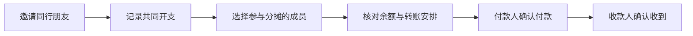

# 喵喵旅账 · TripSplit 🐱

[English](README.md) · **简体中文** · [返回 Bill 的主页](../../README.zh-CN.md)

**少算一点账，多享受旅程。**

六个人的晚餐，三个人的出租车，还有朋友使用另一种货币付款。一起旅行有许多小小的记账问题，也有更多值得花时间的事情。

喵喵旅账是一个微信多人旅行账本：记录共同开支，选择参与成员，了解最后需要怎样转账。

## 一段旅程里的三个时刻

1. **“这次谁一起去？”** 朋友加入同一个旅程；由他人代记的成员也有清楚的身份说明。
2. **“这笔费用谁参加了？”** 每笔开支分别选择参与成员，保留原币金额、结算币种和保存时的汇率。
3. **“这笔账结清了吗？”** 核对需要进行的转账。付款与收款分别确认，并保留双方的确认记录。

## 我觉得有意思的产品选择

公平需要能够核对的解释。只有一个总额，朋友很难理解自己为什么需要支付这笔钱。费用的参与成员、原始币种和确认记录，为大家提供共同的参照。

同行的各种情况也需要得到照顾：有人后来加入，有人为大家垫付，还有人想确认转账是否收到。产品流程为这些交流留出了位置。

## 产品入口

这里展示产品流程与设计思路。微信中的公开使用状态尚未核查，因此暂时没有放置启动码或在线演示入口。希望了解使用方式，可以[联系 Bill](https://github.com/Bill306/Bill306/issues)。

微信公众号：**比尔的小屋**。
