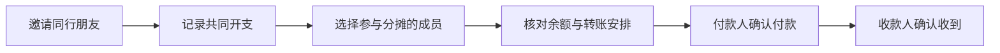

# 喵喵旅账 · TripSplit 🐱

[English](README.md) · **简体中文** · [返回 Bill 的主页](../../README.zh-CN.md)

**少算一点账，多享受旅程。**

六个人的晚餐，三个人的出租车，还有朋友使用另一种货币付款。一起旅行有许多小小的记账问题，也有更多值得花时间的事情。

喵喵旅账是一个微信多人旅行账本：记录共同开支，选择参与成员，了解最后需要怎样转账。

**[开始浏览产品导览](#product-tour)** · [阅读结算设计案例](#settlement-decision) · [了解微信使用方式](https://github.com/Bill306/Bill306/issues/new?title=TripSplit%20product%20access)

## 产品导览

这份公开导览按照现有小程序的记账与结算流程组织，可以直接在 GitHub 阅读。使用小程序本身，需要通过 Bill 了解微信中的访问方式。

[记录一笔开支](#record-expense) → [核对分摊结果](#review-expense) → [确认一笔转账](#confirm-transfer)

### 记录一笔开支

选择付款人、参与这笔费用的成员，再填写金额与币种。表单支持平均分摊和按照份数分摊。编辑过程中会保存草稿，返回表单时可以恢复已经填写的内容与成员选择。

**关注这个设计：** 付款人与分摊成员分别选择。一位朋友可以垫付整笔费用，由实际参与的部分成员承担费用。

[继续查看费用详情](#review-expense)

### 核对分摊结果

费用详情展示付款人，以及每位参与成员承担的金额。使用外币记账时，页面同时展示原币金额，并说明使用的保存汇率或实际扣款金额。

**关注这个设计：** 原始消费与结算金额保留联系，朋友可以一起核对换算依据和自己的分摊结果。

[继续查看结算](#confirm-transfer)

### 确认一笔转账

查看结算建议中的转账安排。结算进行期间，付款人通过微信或银行完成转账，再标记已经付款。收款人核对到账记录后，确认收到款项。应用保存双方的确认记录。

页面中的状态依次为 **待转账 → 已标记付款，待收款人确认 → 已确认收款**。更新之前，确认窗口会展示双方与金额。

[阅读付款与收款分别确认的原因](#settlement-decision)

## 设计选择：付款与收款分别确认

**用户的问题。** “已经转出”和“已经收到”分别来自两个人的观察。同行朋友需要知道接下来还在等待谁的确认。

**产品设计。** 结算进行期间，由付款人标记付款，由收款人确认到账。两次操作之间，等待收款确认的状态保持可见。确认窗口提醒操作的人核对转账，再更新记录。

**带来的影响。** 结清一笔转账，需要收款人多完成一次确认。同时，同行朋友获得一个明确的位置，分别记录转出与到账。

**对应的使用场景。** 付款人已经转出款项，收款人还有待确认到账。其他成员查看时，可以通过等待收款确认的状态，了解接下来需要进行的操作。

## 设计选择：保留开支的原始币种

原始币种、原币金额和保存的换算信息，帮助旅行成员理解结算金额。如果实际扣款金额更适合共同核对，表单也允许使用这个金额。旅程结束之后，大家仍然有足够的信息讨论一笔费用。

## 依据与产品使用方式

本案例根据当前记账表单、费用详情和结算界面整理。微信中的公开使用状态和新一轮双账号运行尚未核查。希望使用小程序，可以[联系 Bill 了解访问方式](https://github.com/Bill306/Bill306/issues/new?title=TripSplit%20product%20access)。

微信公众号：**比尔的小屋**。
